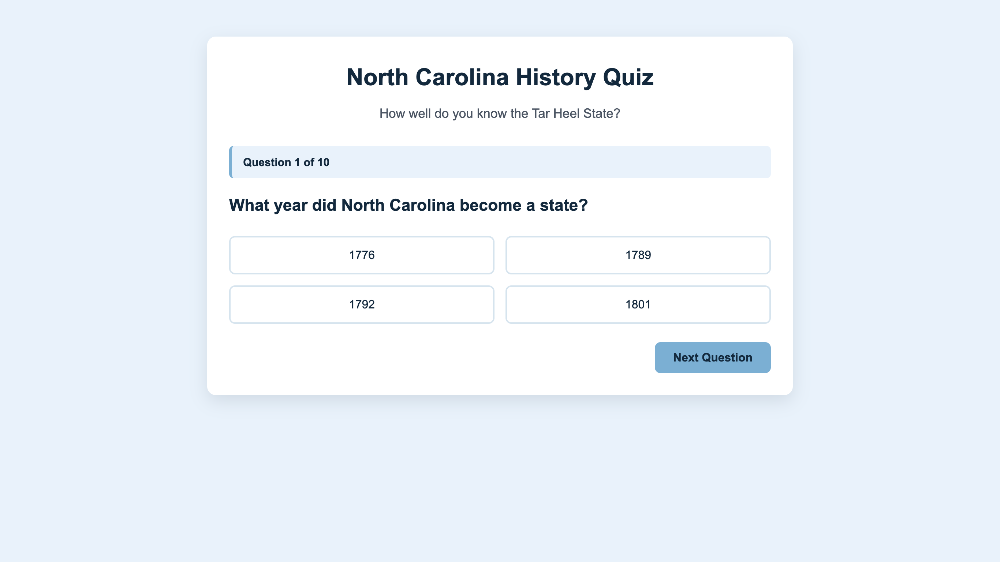
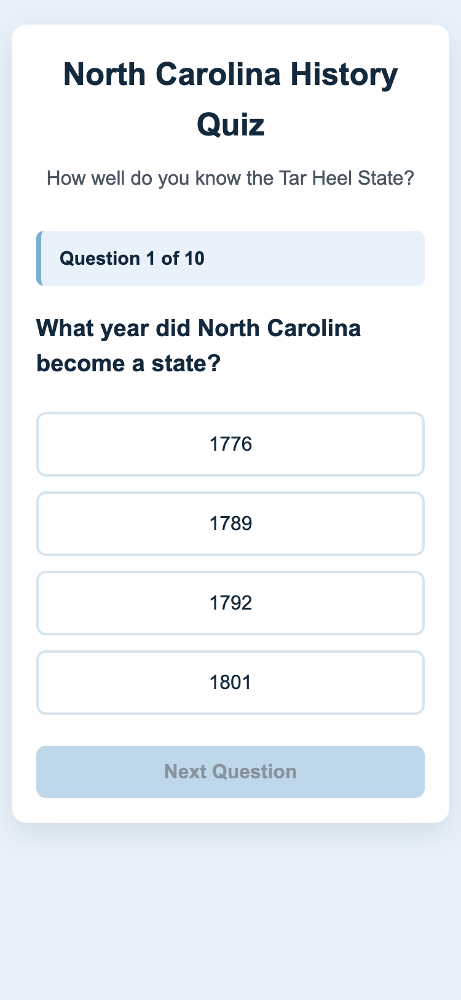
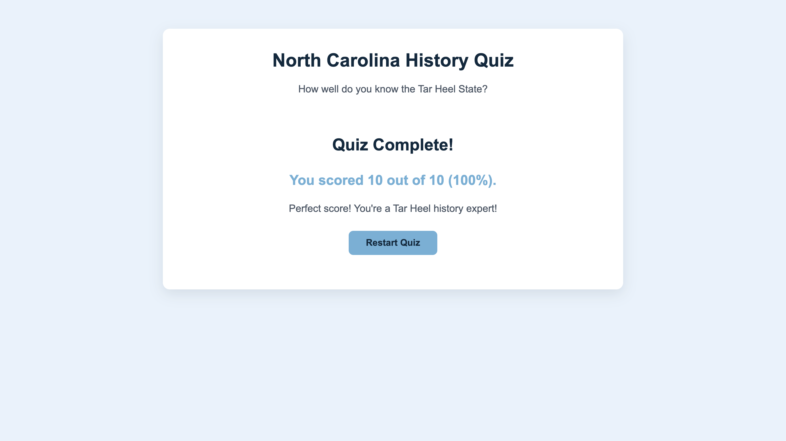

# North Carolina History Quiz

- An interactive, responsive web applicaiton designed to test users' knowledge of North Carolina history through a series of multiple-choice questions.

- Built using HTML5, CSS3, and vanilla JavaScript, this project demonstrates front-end development fundamentals, including DOM manipulation, event handling, responsive design, and interactive user feedback.

## Project Overview

- The North Carolina History Quiz challenges users to answer 10 questions covering historical events, important figures, landmarks, and milestones in North Carolina's history.

- Users receive immediate visual feedback after selecting an answer, can track their progress throughout the quiz, and receive a final score and perfomance message upon completion.

## Features

- 10 multiple-choice questions about North Carolina history.
- Dynamic question and answer rendering using JavaScript.
- Immediate visual feedback for correct and incorrect answers.
- Automatic score tracking throughout the quiz.
- Question progress indicator. 
- Final results displaying the score and percentage.
- Personalized performance messages based on quiz results.
- Restart functionality to retake the quiz.
- Responsive layouts for mobile, tablet, and desktop screens.
- Keyboard-accessible answer and navigation buttons.

## Technologies Used

- **HTML5** - Provides the semantic structure of the application.
- **CSS3** - Handles layout, styling, responsive design, and visual feedback.
- **JavaScript (ES6+)** - Manages quiz logic, DOM manipulation, event listeners, and score tracking.
- **Visual Studio Code** - Development environment.
- **Safari Web Inspector** - Used for debuggin and responsive design testing.

## Installation

- This program runs directly in a web browser and does not require any additional dependencies.

1. Download or clone the project respository.
2. Open the `Interactive_Quiz_App` folder. 
3. Open `index.html` in a modern web browser.

- Alternatively, open the project in Visual Studio Code and use the Live Server extension to launch the application.

## How to Use

1. Read the North Carolina history question displayed on the screen. 
2. Select one of the four multiple-choice answers. 
3. Review the visual feedback showing the correct answer. 
4. Click **Next Question** to continue.
5. Complete all 10 questions to view your final score and percentage. 
6. Click **Restart Quiz** to start a new attempt.

## Screenshots

### Desktop View

- The quiz interface displayed on a desktop screen.

### Mobile View

- The responsive quiz layout optimized for smaller screens.

### Quiz Results

- The results screen displaying the final score, performance feedback, and restart option.

